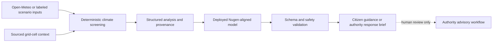
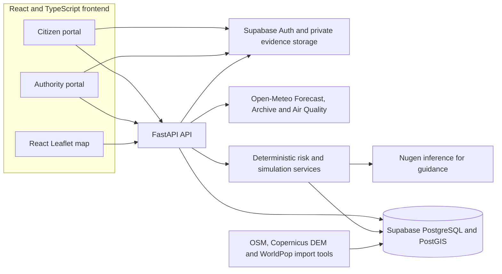

# CLIMAGUARD AI

**AI-Assisted Climate Risk Intelligence & Citizen Response Platform**<br>
Indradhanu 2026 · **AI for Climate Change**

    

CLIMAGUARD AI brings climate screening, geographic context, AI-assisted preparedness guidance and citizen reporting into one Pune-focused prototype. It turns source-labeled environmental estimates into understandable risk indicators, while keeping public alerts behind an authenticated authority workflow. **It is decision support, not an official forecasting or emergency-dispatch system.**

> **Project state:** The application and local integrations have been tested. No public deployment URL or demonstration video has been verified. [Deployment checklist](docs/DEPLOYMENT.md) · [Latest project status](docs/PROJECT_STATUS.md)

## Contents

- [The problem and approach](#the-problem-and-approach)
- [What the prototype does](#what-the-prototype-does)
- [Live and demo modes](#live-and-demo-modes)
- [AI workflow](#ai-workflow)
- [Architecture](#architecture)
- [Technology](#technology)
- [Risk methods and data](#risk-methods-and-data)
- [Screenshots and demonstration](#screenshots-and-demonstration)
- [Run locally](#run-locally)
- [Configuration and API](#configuration-and-api)
- [Verification and limitations](#verification-and-limitations)
- [Credits and license](#credits-and-license)

## The problem and approach

Weather, air quality, geographic evidence and local reports are often spread across separate tools. A resident may see rainfall numbers without knowing their source or how to interpret them; a responder may lack a clear path from an unverified report to a reviewed public advisory.

CLIMAGUARD AI connects **environmental risk screening, scenario simulation, contextual Nugen preparedness recommendations, and a human-verified citizen–authority response workflow**. It shows what evidence is available, marks missing inputs, and distinguishes model estimates, hypothetical inputs and official alerts.

## What the prototype does

| Area | Implemented capability | Boundary |
| --- | --- | --- |
| Climate intelligence | Open-Meteo weather, archive and air-quality integration; deterministic flood, heat and US AQI screening | Provider data are model estimates or reanalysis; the flood index is not a probability |
| Geographic intelligence | Selectable Pune 3 × 3 analysis grid, Leaflet screening layers, PostGIS-backed mapped OSM facilities and roads | Grid cells are not wards or inundation polygons; mapped assets are not verified safe facilities |
| Context | Sourced Copernicus DEM slope, WorldPop cell estimates and OSM mapped-drain proximity for nine cells | Proximity does not establish drainage capacity; population in a cell is not flood-exposed population |
| AI guidance | Real Nugen-aligned inference using structured screening context; validated citizen and authority outputs | Nugen does not calculate hazard scores, verify incidents or publish alerts |
| Citizen portal | Dashboard, location selection, report submission, My Reports, published Live Alerts and emergency contacts | Reports remain unverified until authority review |
| Authority portal | Report review, response planner, advisory drafting, explicit same-authority approval and publication, audit history | Publication requires authenticated action and an expiry; no automatic AI publication |

The last source-backed local readback is described in [PROJECT_STATUS.md](docs/PROJECT_STATUS.md). A fresh deployment needs its own acceptance check.

## Live and demo modes

| | Live mode | Demo mode |
| --- | --- | --- |
| Environmental inputs | Available Open-Meteo model estimates with timestamps | Explicit hypothetical inputs; not current observations |
| Flood screening | Deterministic index with available geographic inputs | The **same** rules recalculate a hypothetical index |
| Map | Live screening by grid cell | Extreme-rainfall preset recolors each cell from its calculated score |
| Nugen | On-demand guidance grounded in live analysis | On-demand **real Nugen inference** grounded in simulated analysis |
| Records | Authorized reports, drafts and alerts use Supabase | Simulation does not write environmental observations, incidents or official alerts |

The extreme-rainfall preset assumes **25 mm/h for six hours**. In the 6 November 2026 local readback, sourced cell slopes produced indices from **89.4 to 92.4/100**. All nine cells fall in the existing *Severe* band, so they share its map color even though their numeric scores differ. These are calculated, hypothetical **heuristic indices**, not calibrated flood probabilities or flood-inundation extents. [Demo walkthrough](docs/DEMO_GUIDE.md)

## AI workflow



The aligned model is selected by server-side `NUGEN_MODEL_ID`; the configured inference client calls Nugen's chat-completions endpoint. The model writes contextual preparedness language from calculated results. Backend validation rejects malformed or unsafe output and keeps risk levels under deterministic control. Simulation guidance is identified as hypothetical and is not stored as an official draft. [AI integration and safeguards](docs/AI_INTEGRATION.md)

## Architecture



FastAPI verifies bearer tokens and roles for protected routes; Supabase row-level security and database transition guards add enforcement. The frontend uses a publishable Supabase credential; privileged keys stay on the server. [Architecture and workflow](docs/ARCHITECTURE.md)

## Technology

| Component | Verified use |
| --- | --- |
| React 19, TypeScript, Vite 7, Tailwind CSS 4 | Citizen and authority interfaces |
| React Leaflet, Leaflet, Recharts | Selectable grid map and environmental charts |
| FastAPI, Pydantic, httpx | Typed API, validation, asynchronous provider clients |
| Supabase PostgreSQL, PostGIS, Auth and Storage | Records, spatial queries, role-aware access and private incident evidence |
| Open-Meteo | Weather forecast, historical reanalysis and air-quality estimates |
| Copernicus DEM, WorldPop, OpenStreetMap | Sourced cell context and mapped infrastructure |
| Nugen-aligned model | On-demand, validated preparedness guidance |

Exact dependency ranges are in [frontend/package.json](frontend/package.json) and [backend/requirements.txt](backend/requirements.txt).

## Risk methods and data

The flood index normalizes available rainfall and optional sourced terrain, drainage-capacity and verified historical-exposure terms, then renormalizes remaining weights when inputs are missing. Mapped drain **distance is displayed but never treated as verified capacity**. Low, moderate, high and severe are project screening bands, not observed flood states. There are no verified flood-event labels, trained XGBoost artifact, held-out calibration results or SHAP explanations in this repository.

Heat uses air temperature, humidity and a heat-index calculation where valid; it does not issue an official heatwave warning. Air quality displays provider **US AQI**, never Indian AQI, with pollutant units and timestamps. Grid-cell population is not a count of people exposed to flooding because no validated hazard footprint is available. Read the [risk methodology](docs/RISK_METHODOLOGY.md) and [data provenance](docs/DATA_SOURCES.md).

## Screenshots and demonstration

**Prototype URL:** Coming soon · **Demo video URL:** Coming soon

Authentic screenshots have not yet been added. The [screenshot capture checklist](docs/screenshots/README.md) names the seven views to capture: Citizen Dashboard, Pune Risk Map, Extreme Rainfall Demo, Nugen Safety Guidance, Incident Reporting, Authority Dashboard and Published Alerts. Do not treat those placeholders as evidence of a hosted application.

The [seven-minute demonstration guide](docs/DEMO_GUIDE.md) follows the climate problem, live evidence, simulated response and human review flow. [Judge questions](docs/JUDGE_QA.md) and [test evidence](docs/FINAL_TEST_REPORT.md) provide additional context; historical reports there are dated snapshots.

## Run locally

Use Windows PowerShell, Python 3.13 (the repository's [.python-version](.python-version)), and a Node.js version supported by the installed Vite release.

```powershell
git clone https://github.com/ShutReptile990/CLIMAGUARD-AI.git
cd CLIMAGUARD-AI
Copy-Item backend/.env.example backend/.env
Copy-Item frontend/.env.example frontend/.env
cd backend
py -3.13 -m venv .venv
.\.venv\Scripts\python.exe -m pip install -r requirements-dev.txt
.\.venv\Scripts\python.exe -m uvicorn app.main:app --reload --port 8000
```

In a second PowerShell window, from the repository root:

```powershell
cd frontend
npm ci
npm run dev
```

Open `http://127.0.0.1:5173`. Set `VITE_API_BASE_URL=http://127.0.0.1:8000` for these commands, or point it to the actual FastAPI port. The Vite API client appends `/api/v1`. Supabase and Nugen need valid credentials for their respective features; the API health endpoint is `http://127.0.0.1:8000/api/health`. For migration order, Auth redirects, optional geospatial dependencies and troubleshooting, see [setup](docs/SETUP.md).

## Configuration and API

Copy only the supplied [backend](backend/.env.example) and [frontend](frontend/.env.example) templates. Browser variables are `VITE_API_BASE_URL`, `VITE_SUPABASE_URL` and `VITE_SUPABASE_PUBLISHABLE_KEY`. Server variables include `SUPABASE_URL`, `SUPABASE_PUBLISHABLE_KEY`, `SUPABASE_SECRET_KEY`, `NUGEN_API_KEY`, `NUGEN_MODEL_ID`, `NUGEN_INFERENCE_URL` and `CORS_ORIGINS`. Never put a server secret or database password in a `VITE_` variable. See [SETUP.md](docs/SETUP.md) for the full configuration list.

FastAPI documents the canonical `/api` routes at `/docs` when running locally. The frontend uses matching `/api/v1` aliases. Major groups are `/health`, `/environment/{zone_id}`, `/zones/geojson`, `/map/*`, `/analysis/*`, `/nugen/*`, `/incidents`, `/alerts` and `/profile`. Incident review is **PATCH** `/incidents/{incident_id}/review`; alert transitions are separate authenticated POST routes. [Architecture/API notes](docs/ARCHITECTURE.md)

## Verification and limitations

From `backend`, run `.\.venv\Scripts\python.exe -m pytest app\tests -q`. From `frontend`, run `npm run build` (TypeScript check plus Vite bundle). The most recent completed run for the extreme-rainfall phase was **80 backend tests passed** and a successful frontend build. A real Nugen simulated B2 request through FastAPI returned HTTP 200 and three validated actions; the B2 browser check showed matching card and map-popup scores. These local results do not establish a hosted deployment. [Project status](docs/PROJECT_STATUS.md)

The prototype covers a defined Pune analysis grid, not the entire city. Environmental feeds may fail or become stale. Drainage condition/capacity, verified historical flood labels, calibrated flood probabilities, hazard footprints and operational validation remain unavailable. Wider geographic deployment requires suitable local datasets, security review and evaluation with relevant authorities. The expected benefit is clearer localized awareness and an accountable report-to-alert path; no measured reduction in losses or response time is claimed.

## Credits and license

Contributor names and roles: **to be supplied by the project team**. Data credits and terms are in [DATA_SOURCES.md](docs/DATA_SOURCES.md). The repository retains its existing [MIT License](LICENSE) and copyright notice.
