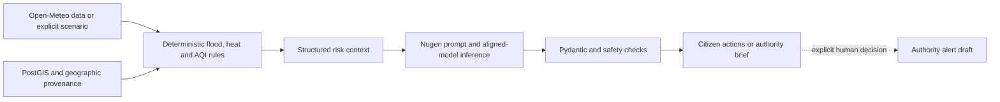

# Nugen AI integration

[Project overview](../README.md) · [Architecture](ARCHITECTURE.md) · [Risk methods](RISK_METHODOLOGY.md)

## Role of the aligned model

CLIMAGUARD AI uses a deployed **Nugen-aligned model** to explain deterministic screening results and produce preparedness actions. It does not ask the model to calculate rainfall, flood probability, US AQI, heat index, infrastructure damage or incident validity. The backend's `NUGEN_MODEL_ID`, `NUGEN_API_KEY` and `NUGEN_INFERENCE_URL` identify the deployed model and endpoint; the API key stays in the backend environment. The currently documented model identifier in local deployment records is `model_01m66gqc3qk10zdy`. Verify that identifier against the active deployment before a public demo.

## Request path and output contract

The citizen and authority buttons call `POST /api/v1/nugen/citizen/{locality_id}` or `POST /api/v1/nugen/authority/{locality_id}`. The authority route requires a verified authority or admin role. `GET /api/v1/nugen/status` reports configuration/recent availability, and `GET /api/v1/nugen/scenarios` lists the server-owned demo presets. Omitted or `{ "mode": "live" }` input uses live analysis. Simulation accepts `{ "mode": "simulation", "scenario_id": "extreme_rainfall" }` or another listed preset; clients cannot submit arbitrary values to this route.

The backend constructs a compact context containing the selected cell, hazard status/level/score/method, factors, missing-data warnings, source times, available geographic metrics and scenario ID. It requests JSON with a summary, risk explanation, **exactly three** unnumbered action sentences and limitations. The returned public response is Pydantic-validated. The inference client also checks the model identity, response shape, truncation and unsupported numerical claims. Unsafe claims that a hypothetical emergency or official evacuation is occurring are rejected. An invalid formatting response may be retried once against the **same Nugen model** with stricter instructions; there is no mock or alternate-provider fallback.

Backend code: [`app/integrations/nugen.py`](../backend/app/integrations/nugen.py), [`app/services/nugen_guidance.py`](../backend/app/services/nugen_guidance.py), [`app/schemas/nugen.py`](../backend/app/schemas/nugen.py). The UI is [`NugenGuidancePanel.tsx`](../frontend/src/components/NugenGuidancePanel.tsx).

## Live versus simulation

Live guidance uses current available environmental analysis and may store an **unapproved** recommendation draft with model ID, inference time and source analysis in `ai_recommendations`. That is not a public alert. If required evidence is unavailable, guidance can return an explicit error. Simulation uses server-defined hypothetical inputs and sourced geographic context but no live weather/air-quality bundle. It is marked *SIMULATION — NOT LIVE CONDITIONS* and is **not stored** in the recommendation table or alert queue. Nugen cannot create, approve or publish official alerts; an authenticated authority must separately draft, submit, approve and publish with an expiry.

The extreme rainfall preset is **25 mm/h for six hours**. It drives both the nine-cell demo map and the selected cell's Nugen risk context through `flood-rainfall-index-v1`. Other demo presets cover severe heat and combined rainfall/heat; no AQI simulator exists, so simulated AQI is unavailable. Selecting a different Nugen preset does not re-label the extreme-rainfall map as that scenario.

## Evidence and limitations

On 6 November 2026, a real FastAPI B2 simulation request reached the configured Nugen endpoint with HTTP 200 and returned three validated actions; its source context carried B2's **91.5/100 heuristic flood index** and response persistence was `not_stored_simulation`. This demonstrates that local integration, not hosted uptime or advice effectiveness. Nugen language remains advisory and should be checked against official local instructions. No model claim is a verified flood forecast, safe route or dispatch order.
