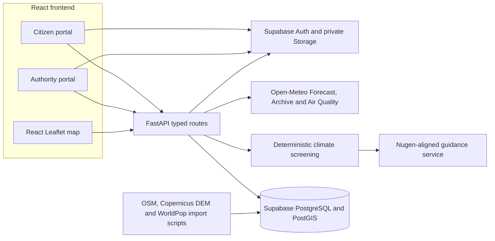
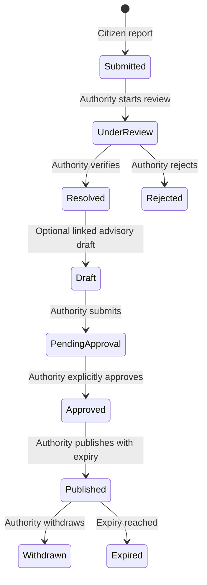

# System architecture

[Project overview](../README.md) · [Local setup](SETUP.md) · [AI integration](AI_INTEGRATION.md)

CLIMAGUARD AI is a Pune pilot with a reproducible 3 × 3 WGS84 analysis grid. Its cells are **not** municipal wards, flood-inundation polygons or official warning zones. Citizen and authority screens share the selected area through React context.

## Components and data flow

1. **Frontend.** [`frontend/src/main.tsx`](../frontend/src/main.tsx) defines citizen/authority routes. [`frontend/src/context.tsx`](../frontend/src/context.tsx) shares the selected Pune overview or grid-cell ID and the live/demo mode. The typed client in [`lib/api.ts`](../frontend/src/lib/api.ts) calls `/api/v1`; Vite can proxy `/api` locally. TanStack Query handles loading and refetching. Leaflet renders actual grid GeoJSON, OpenStreetMap tiles, source-backed map markers/roads and risk screening colors.
2. **API.** [`backend/app/main.py`](../backend/app/main.py) registers lifespan-managed provider clients, CORS, structured request logging, exception handlers and response models. Canonical Swagger routes are under `/api`; the same routers are available to the frontend under `/api/v1`. Public environmental endpoints do not require login. Supabase-authenticated JWTs and profile roles gate protected operations.
3. **Environmental integration.** [`OpenMeteo`](../backend/app/services/open_meteo.py) retrieves forecast, archive and air-quality model data with explicit units/times, bounded cache and unavailable/error states. [`EnvironmentService`](../backend/app/services/environment.py) assembles a per-area bundle and can persist selected current records. The provider is not a local rain gauge or air monitor.
4. **Geographic integration.** [`zones.py`](../backend/app/services/zones.py) builds nine deterministic cells. PostGIS stores the sourced Copernicus DEM slope, WorldPop population estimates, OSM waterways, facilities and roads. Map endpoints query bounded spatial RPCs when imported; a **labeled** validated local OSM preview is available when database integration is absent. The current project's 5 November 2026 readback found **1,030 facilities, 5,438 major roads and 213 waterways in PostGIS**; runtime availability still depends on connecting that project.
5. **Risk and guidance.** [`risk_engine.py`](../backend/app/services/risk_engine.py) calculates transparent flood, heat and US AQI screening. [`analysis.py`](../backend/app/services/analysis.py) adds feature availability, exposure co-location, provisional priority and explicit simulation. The Nugen service receives those structured results on demand and validates its response before display. It never sets numeric hazard scores or publishes alerts.
6. **Records.** The API uses Supabase PostgREST and user JWTs for role-scoped records. The optional direct PostgreSQL connection is for import utilities. `incident_reports`, `alerts`, `audit_logs`, `ai_recommendations`, `zones`, environmental observations and spatial tables are defined by [migrations 001–010](../database/README.md). No migration should be reapplied to a populated project without checking state.

## Security and human review

The browser has only a Supabase **publishable** credential. [`backend/app/core/auth.py`](../backend/app/core/auth.py) verifies identity and profile role. RLS policies in [`002_security.sql`](../database/migrations/002_security.sql), the private evidence bucket in [`008_workflows.sql`](../database/migrations/008_workflows.sql), and later database transition guards enforce record ownership and authority actions. New users begin as citizens; users cannot self-assign authority/admin through the app. The backend secret credential is server-side for privileged ingestion and selected audited operations.

The same authorized authority may approve and publish after migration 010, but each transition is separate and audited. The public alert API returns only published, unexpired records. AI guidance and citizen reports do **not** automatically enter that published state. See [workflow setup](PHASE6_WORKFLOW_SETUP.md).

## API groups

FastAPI's `/docs` is the authoritative contract. Implemented groups include:

| Public/read scope | Protected/write scope |
| --- | --- |
| `GET /api/v1/health`, `/zones`, `/zones/geojson`, `/environment/{zone_id}`, `/map/screening`, `/map/infrastructure`, `/map/roads` | `GET/PATCH /api/v1/profile`; admin-only `/profiles/{profile_id}/role` |
| `GET /api/v1/analysis/{zone_id}`, `/analysis/compare`, `/analysis/demo/extreme-rainfall`; `POST /analysis/simulate` | `GET/POST/PATCH/DELETE /api/v1/incidents` as role/ownership permits; `PATCH /incidents/{incident_id}/review` for authority/admin |
| `GET /api/v1/nugen/status`, `/nugen/scenarios`; `POST /nugen/citizen/{locality_id}` | `POST /api/v1/nugen/authority/{locality_id}` for authority/admin; alert draft, review and publish routes for authority/admin |
| `GET /api/v1/alerts` returns active published alerts | `POST /api/v1/alerts/{alert_id}/submit`, `/review`, `/publish`, `/withdraw` and related audit/archive routes |

Protected endpoints also rely on Supabase policies. Their precise parameters and schemas are in `/docs`; the table is a navigation summary, not an authorization matrix.

## Deployment boundary

[`render.yaml`](../render.yaml) prepares FastAPI hosting and [`frontend/vercel.json`](../frontend/vercel.json) prepares SPA routing. The repository has **no verified public hosted URL** as of this documentation update. After deployment, configure exact backend CORS origins and Supabase Auth redirects, then repeat end-to-end checks at the actual HTTPS origins. [Deployment guide](DEPLOYMENT.md)
