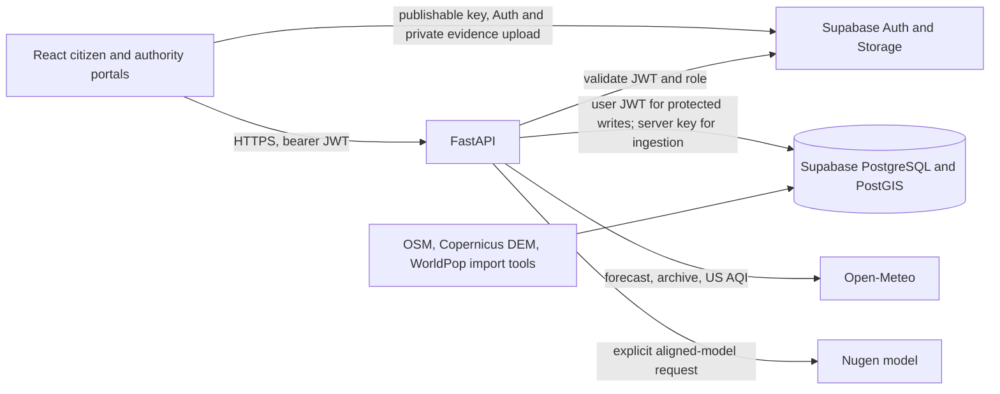

# CLIMAGUARD AI system architecture

CLIMAGUARD AI is a Pune pilot with nine reproducible grid cells. They are analysis cells, not municipal wards or flood-inundation polygons. The application has separate citizen and authority views over one shared selected cell.

## Runtime data flow

1. `frontend/` uses React, TypeScript, Vite, TanStack Query, Leaflet and Recharts. Shared context holds the selected `pune` overview or one grid-cell ID. Public screens call typed `/api/v1` routes; incident and authority screens attach a Supabase Auth access token. The browser contains only the Supabase publishable credential.
2. `backend/app/main.py` configures CORS, exception handlers, request logging, lifespan clients and typed FastAPI routes. Auth dependency verifies the token with Supabase Auth, then reads the profile role using the user token. Protected PostgREST writes retain RLS. Server-side credentials are used only for privileged ingestion/audited operations.
3. Open-Meteo Forecast supplies current model estimates and forecast periods. Air Quality supplies **US AQI** and pollutants, not Indian AQI. Historical Archive supplies reanalysis. The backend validates units/timestamps, caches bounded requests, and returns explicit unavailable streams on provider failure. Selected current values can be persisted in Supabase.
4. Deterministic flood, heat and air-quality rules create risk assessments with source times, factors and limitations. The flood score is a **heuristic index**, not a calibrated probability. The simulator remains separate from real forecasts. No trained flood model or validated hazard footprint exists.
5. PostGIS stores nine zone geometries, WorldPop estimates, sourced Copernicus slope, mapped-drain proximity and 213 OSM waterways. Exposure reports geographic co-location; it does not assert physical damage. Potential flood-exposed population is unavailable without a validated hazard footprint. Hospital/school/road maps currently fall back to a validated local OSM GeoJSON preview because no `osm_import_runs` record exists in the live project.
6. The deployed Nugen-aligned model (`model_01m66gqc3qk10zdy`) receives source-backed deterministic analysis only after a user presses Generate. Pydantic validates output; unsupported numeric claims are rejected and deterministic levels stay under backend control. Successful inference stores an unapproved recommendation draft with provenance. No other LLM provider is configured.
7. Citizen reports enter `submitted`, then authorized review can move them to `under_review` and `resolved` or `rejected`. Database triggers enforce transitions and write audit history. A verified incident can be linked to an advisory draft for the same grid cell. Migration 010 allows the same authenticated authority to edit, submit, explicitly approve and publish the advisory with an expiry. Published edits and withdrawals are audited. Nugen cannot approve or publish. Only published, unexpired alerts are returned as active by the API. Migration 010 was owner-applied; its column is confirmed, while a live self-approval transition remains to be tested.

## Deployment boundary

The prepared deployment uses Vercel for the Vite SPA, Render for FastAPI, the existing Supabase project, and the existing Nugen model. `frontend/vercel.json` handles route refreshes; `render.yaml` binds to the host-provided port. Exact public origins must be configured in backend CORS and Supabase Auth redirects. The project has **not** been publicly deployed or hosted-verified from this workspace; see [deployment steps](DEPLOYMENT.md) and [test evidence](FINAL_TEST_REPORT.md).
